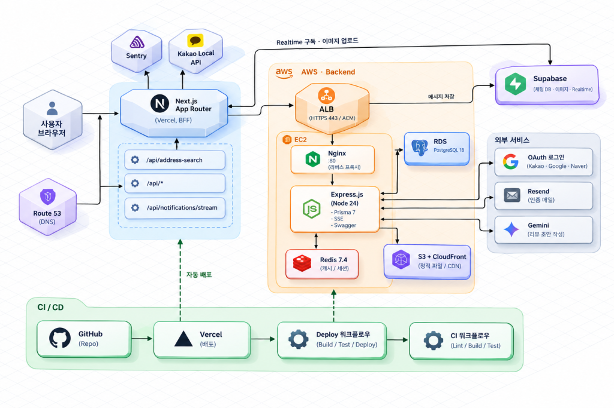

<div align="center">
  
</div>

# 🚚 Moving — 무빙

**편리하고 믿을 수 있는 이사 중개 서비스**

- 서비스 주소: [moving-team3.xyz](https://moving-team3.xyz)
- Frontend: [13-moving-team3-fe](https://github.com/damdadaxx/13-moving-team3-fe)
- Backend: [13-moving-team3-be](https://github.com/damdadaxx/13-moving-team3-be)

# 📜 목차

1. [프로젝트 소개](#📝-프로젝트-소개)
2. [기능 시연 영상](#💻-기능-시연-영상)
3. [시스템 아키텍처](#-시스템-아키텍처)
4. [기술 스택](#️-기술-스택)
5. [주요 라이브러리](#📚-주요-라이브러리)
6. [팀 소개 및 문서](#👥-팀-소개-및-문서)
7. [개인별 주요 작업 내역](#📋-개인별-주요-작업-내역)
8. [프로젝트 구조](#📁-프로젝트-구조)
9. [주요 기능 상세](#🌟-주요-기능-상세)
10. [성능 최적화 전략](#🚀-성능-최적화-전략)
11. [트러블 슈팅](#💣-트러블-슈팅)

<br/>

# 📝 프로젝트 소개

- 이사 소비자와 이사 전문가를 연결하는 이사 견적 매칭 서비스입니다.

고객은 이사 정보를 등록하고 기사님의 견적을 비교할 수 있으며,
기사님은 받은 요청을 확인하고 견적을 제안할 수 있습니다.

프로필, 찜하기, 리뷰, 실시간 알림과 1:1 채팅을 통해
이사를 준비하는 과정에서 필요한 정보와 소통을 제공합니다.

<br/>

# 💻 기능 시연 영상

### 고객

[](https://www.youtube.com/watch?v=DfR7eHb9VYA)

### 기사님

[](https://www.youtube.com/watch?v=SPF-6KNENOQ)

<br/>

# 🚧 시스템 아키텍처

<div align="center">
  
</div><br/>

# ⚙️ 기술 스택

### ✅ Language


### ✅ Framework & Libraries

**Frontend**


**Backend — 별도 저장소에서 관리**


### ✅ Hosting & Deployment


- **Vercel**: Next.js 프론트엔드 배포
- **AWS EC2**: 백엔드 API 서버 배포
- **Amazon CloudFront**: S3에 저장한 프로필 이미지 제공
- **Amazon Route 53**: 서비스 도메인 DNS 관리

### ✅ Storage & Database


- **PostgreSQL**: 서비스 도메인 데이터 저장
- **Redis**: 백엔드 API 캐싱 — 연결 설정이 있는 환경에서 사용
- **Amazon S3**: 고객·기사님 프로필 이미지 저장
- **Supabase**: 채팅 데이터, Realtime 구독 및 채팅 이미지 Storage

### ✅ CI/CD


- **Frontend**: Vercel 배포
- **Backend**: GitHub Actions를 통한 린트·빌드·테스트 및 EC2 배포

### ✅ Monitoring


### ✅ Version Control


<br/>

# 📚 주요 라이브러리

아래는 프론트엔드에서 실제 사용하는 라이브러리와 자체 구현 구성입니다.
별도 라이브러리를 사용하지 않는 항목은 내장 API 또는 자체 구현으로 구분했습니다.

<details>

<summary>데이터 패칭 / 캐싱</summary>

- **@tanstack/react-query**: 서버 데이터 조회·캐싱·Mutation 및 커서 기반 무한 스크롤
- **@tanstack/react-query-devtools**: Query 상태와 캐시 확인
- 도메인별 `keys.ts`, `queries.ts`, `mutations.ts`로 조회·변경 로직 분리

</details>

<details>
<summary>상태 관리 — React 내장 기능</summary>

- **React Context API**: 인증 정보·모달·토스트 등 공통 상태와 동작 공유
- **React Hooks**: 화면별 입력·선택·열림 상태 관리
- 전역 상태 라이브러리 없이 서버 데이터는 TanStack Query, UI 공통 상태는 Context로 역할 분리

</details>

<details>
<summary>국제화(i18n)</summary>

- **next-intl**: 한국어·영어·중국어·일본어 번역 및 locale 라우팅
- locale을 유지하는 공용 Link·Router 사용
- 번역 메시지는 `messages/ko.json`, `en.json`, `zh.json`, `ja.json`에서 관리

</details>

<details>
<summary>폼 / 입력값 검증</summary>

- **react-hook-form**: 입력값·오류·제출 상태 관리
- **zod**: 회원가입·프로필·견적 등 입력값의 스키마 기반 검증
- **@hookform/resolvers**: Zod 스키마와 React Hook Form 연결

</details>

<details>
<summary>스타일 / 공통 컴포넌트</summary>

- **tailwindcss**: Mobile First 반응형 스타일과 공통 디자인 토큰
- **class-variance-authority**: Button·Input·Chip 등 공용 UI의 크기·종류·상태별 스타일 정의
- **clsx**: 조건부 클래스 문자열 조합
- **tailwind-merge**: 충돌하는 Tailwind 클래스 병합
- `clsx`와 `tailwind-merge`를 조합한 공용 `cn()` 함수 사용

</details>

<details>
<summary>UI / UX 보조</summary>

- **framer-motion**: 랜딩 페이지·인트로·스크롤 등장 등 애니메이션
- **react-responsive**: 화면 크기에 따른 반응형 값 선택
- **react-calendar**: 이사 날짜 선택 달력
- **next-flex-rating**: 리뷰 별점 표시 및 입력
- **react-loader-spinner**: 페이지·섹션 및 버튼의 대기 상태 표시
- **자체 구현 Skeleton**: 화면 구조에 맞는 로딩 자리표시
- **자체 구현 Modal·Toast**: Context와 Portal을 이용한 공통 안내 UI

</details>

<details>
<summary>인증 / API 통신 — 자체 구현</summary>

- **Fetch API**: 브라우저·서버 공용 Fetch 래퍼를 통한 요청 처리
- **Next.js Route Handler**: 같은 출처의 `/api/*` 요청을 백엔드로 전달
- **clientFetch**: 응답 파싱, 공통 오류 변환, 인증 만료 시 갱신·재시도
- **AuthProvider·AuthGuard**: 로그인 상태 공유와 역할별 화면 접근 제어
- **ProfileGuard**: 프로필 등록 여부·조회 상태에 따른 화면 흐름 제어

</details>

<details>
<summary>날짜 / 금액 / 포맷 — 내장 API 및 공용 유틸</summary>

- **Intl.DateTimeFormat**: 언어별 날짜 표시
- **Intl.RelativeTimeFormat**: 상대 시간 표시
- **Intl.NumberFormat**: 언어별 숫자·금액 표시
- 공용 훅으로 날짜·금액·경력의 다국어 표시 방식 통일
- 전화번호·지역·주소·이미지 URL 등의 변환은 공용 유틸로 관리

</details>

<details>
<summary>네트워킹 / 실시간</summary>

- **@supabase/supabase-js**: 채팅 메시지 변경 구독 및 채팅 이미지 업로드
- **Fetch API·ReadableStream**: SSE 알림 스트림 수신
- **IntersectionObserver**: 목록 하단 감지를 이용한 공용 무한 스크롤
- SSE와 무한 스크롤은 별도 폴리필·관찰 라이브러리 없이 구현

</details>

<details>
<summary>이미지 / 아이콘</summary>

- **next/image**: 프로필·정적 이미지 표시와 이미지 최적화
- **@svgr/webpack**: SVG 에셋을 React 컴포넌트로 변환
- CloudFront·Supabase 등 사용하는 외부 이미지 호스트를 `remotePatterns`에서 관리
- 프로필 이미지는 백엔드에서 S3에 저장하고 CloudFront URL로 제공
- 채팅 이미지는 Supabase Storage를 사용

</details>

<details>
<summary>모니터링</summary>

- **@sentry/nextjs**: 브라우저·서버 오류 수집과 성능 추적
- 소스맵 업로드 설정으로 오류 위치 확인 지원
- 세션 리플레이는 초기 렌더링 이후 지연 로드

</details>

<details>
<summary>개발 도구</summary>

- **typescript**: 정적 타입 검사
- **@types/node**, **@types/react**, **@types/react-dom** 등: 타입 선언
- **eslint**, **eslint-config-next**: 코드 품질 및 Next.js 규칙 검사
- **prettier**: 코드 포맷 통일
- **@trivago/prettier-plugin-sort-imports**: 설정한 그룹 순서에 따른 import 정렬
- **@tailwindcss/postcss**: Tailwind CSS의 PostCSS 연동
- **husky**: Git 훅 관리
- **lint-staged**: 커밋 대상 파일의 포맷·린트 처리
- **@commitlint/cli**, **@commitlint/config-conventional**: 커밋 메시지 형식 검사
- **babel-plugin-react-compiler**: Next.js의 React Compiler 활성화 구성

</details>

<br/>

# 👥 팀 소개 및 문서

## 팀원 소개

|    이름    |        역할         |                                                              담당                                                               |                       GitHub                       |                                개인 개발 보고서                                |
| :--------: | :-----------------: | :-----------------------------------------------------------------------------------------------------------------------------: | :------------------------------------------------: | :----------------------------------------------------------------------------: |
| **한효주** |  👑 팀장 · FE 리드  |   |     [@damdadaxx](https://github.com/damdadaxx)     | [📄 보고서](https://app.notion.com/p/damdada/a9d7bbb8e517822b8cf001c2d6b0d714) |
| **방민재** | ⭐ 부팀장 · BE 리드 |   |     [@extermins](https://github.com/extermins)     | [📄 보고서](https://app.notion.com/p/damdada/1177bbb8e51782f68d5e018de1bf3c0e) |
| **김대영** |       🙋 팀원       |   |  [@daeyeong1573](https://github.com/daeyeong1573)  | [📄 보고서](https://app.notion.com/p/damdada/dcd7bbb8e5178322a025817111f1fbdd) |
| **곽서현** |       🙋 팀원       |   |     [@sgwag6799](https://github.com/sgwag6799)     | [📄 보고서](https://app.notion.com/p/damdada/e007bbb8e5178226aa5f01367967e6a2) |
| **윤다정** |       🙋 팀원       |   |    [@torang1013](https://github.com/torang1013)    | [📄 보고서](https://app.notion.com/p/damdada/b087bbb8e51782e883950110bbc4f64f) |
| **전현선** |       🙋 팀원       |   | [@hyeonseon9909](https://github.com/hyeonseon9909) | [📄 보고서](https://app.notion.com/p/damdada/8497bbb8e51782a8be3101e415dc62ae) |

## 팀 문서

### 📝 [팀 노션](https://www.notion.so/damdada/3377bbb8e51782129977817c0da86c23?v=7f37bbb8e51782efa73e8815e7b07056&source=copy_link)

### 📝 [API 문서](https://app.notion.com/p/damdada/API-3c97bbb8e517809bbbcee27e95dabd72)

<br/>

# 📋 개인별 주요 작업 내역

<details>
<summary>한효주 · 팀장</summary>

## Frontend

- **실시간 알림 시스템**
  - SSE 수신 및 재연결 처리
  - 헤더 알림 드롭다운 구현

- **공통 컴포넌트**
  - Header·PageHeader·아이콘 버튼·TopButton·Toast·Skeleton 설계 및 구현
  - 공통 컴포넌트의 크기·반응형 처리 기준 정리
  - 재사용성을 고려한 공통 UI 구조 개선

- **페이지 개발**
  - 랜딩 페이지 인트로·섹션 및 반응형 퍼블리싱
  - 기사님 상세 페이지 구현
  - 대기 중인 견적·받았던 견적·확정 견적 상세 화면 구현
  - 기사님 마이페이지 구현

- **실시간 1:1 채팅**
  - 견적 확정 후 고객·기사님 간 채팅 기능 구현
  - 채팅방·메시지·읽음 처리 API 연동
  - Supabase Realtime 기반 변경 감지 및 채팅 이미지 업로드 연동

- **초기 설정 및 구조 리팩토링**
  - Next.js App Router·TypeScript strict·Tailwind CSS 초기 설정
  - 프로젝트 폴더 구조 설계 및 components/hooks 도메인별 재구성
  - 공용 UI와 기능 컴포넌트의 features/ui 구조 분리
  - 중복 Query·Hook의 도메인별 통합 정리
  - clientFetch의 FormData 처리와 백엔드 응답 파싱 공통화

- **성능·접근성·SEO·분석**
  - 초기 로드 리소스 조정
  - Lighthouse 리포트 기반 웹 접근성 개선
  - 사이트맵·robots.txt 및 GA 동의 배너 구현

</details>

<details>
<summary>방민재 · 부팀장</summary>

## Frontend

- **공통 컴포넌트**
  - Calendar·DateDropdown 구현
  - Button 구현
  - InputSearchbar 구현

- **견적 요청 페이지**
  - 이사 정보 입력 및 견적 요청 화면 구현
  - 공용 달력을 이용한 이사 날짜 선택 UI 적용
  - 카카오 주소 검색을 이용한 출발지·도착지 선택 연동

- **고객 견적 관리 페이지**
  - 대기 중인 견적 페이지 구현 및 백엔드 API 연동
  - 받았던 견적 페이지 구현

- **기사님 견적 관리 페이지**
  - 기사님이 보낸 견적 목록 페이지 구현

</details>

<details>
<summary>김대영</summary>

## Frontend

- **공통 컴포넌트**
  - 공용 Modal(popup·sheet) 구현
  - ModalProvider·useModal 전역 모달 구조 구현
  - useOutsideClick 훅 구현

- **기사님 받은 요청·반려 요청**
  - 받은 요청 화면의 서비스 유형·지정 견적·지역 필터 및 정렬·검색·무한 스크롤 구현
  - 견적 보내기 모달(SendEstimateModal)과 반려 처리 구현
  - 반려 요청 목록 페이지 구현 및 공통 카드·탭 재사용

- **받았던 견적 찜하기**
  - 확정된 견적 카드에 찜하기 버튼 적용

- **다국어 (i18n)**
  - next-intl 기반 한국어·영어·중국어(간체)·일본어 4개 언어 지원
  - 설정·라우팅·네비게이션·번역 작업을 단계별 PR로 분리하여 충돌 최소화
  - `localePrefix: 'as-needed'`로 기존 한국어 URL 유지
  - `ko.json` 타입 등록을 통한 번역 키 타입 검사 적용
  - 번역 키 기반 검증 메시지 구성

- **에러 모니터링**
  - Sentry 기반 프론트엔드 에러 모니터링 설정

</details>

<details>
<summary>곽서현</summary>

## Frontend

- **디자인 시스템**
  - Pretendard 로컬 폰트 및 색상·타이포그래피 토큰 구성
  - 반응형 브레이크포인트와 z-index 기준 정리
  - 조건부 클래스와 Tailwind 클래스 병합을 위한 cn 유틸 구현

- **공통 컴포넌트**
  - Input·Label 구현 및 화면별 라벨 스타일 구성
  - Dropdown의 1열·2열 구성과 키보드 탐색 구현
  - CVA 기반 Sort 스타일 및 정렬 UI 구현

- **인증 공통 로직**
  - AuthProvider·AuthGuard 기반 세션 관리 및 역할별 접근 제어 구현
  - clientFetch의 공통 오류 파싱 및 토큰 갱신 처리

- **로그인·회원가입**
  - 고객·기사님 로그인 및 회원가입 페이지 구현
  - 소셜 로그인 화면 및 인증 흐름 연동
  - 회원가입 이메일 인증 UI 구현

- **기사님 찾기·찜한 기사님**
  - 기사님 찾기 페이지의 검색·필터·정렬·무한 스크롤 구현
  - 찜한 기사님 페이지 구현
  - 기사님 찾기 조건을 URL에 반영해 페이지 이동 후 검색 상태 유지

</details>

<details>
<summary>윤다정</summary>

## Frontend

- **공통 컴포넌트**
  - Tab 구현
  - Pagination 구현

- **찜하기 기능**
  - 기사님 찜하기·취소 기능 구현
  - 찜하기 상태와 관련 화면의 API 연동

- **리뷰 기능**
  - 작성 가능한 리뷰 및 작성한 리뷰 화면 구현
  - 리뷰 작성 UI와 별점·내용 입력 처리
  - 리뷰 조회·작성 API 연동

- **AI 리뷰 초안 작성**
  - Gemini 기반 리뷰 초안 자동 작성 기능 구현
  - 리뷰 초안 생성 API 요청 및 결과 반영 UI 구현

</details>

<details>
<summary>전현선</summary>

## Frontend

- **공통 컴포넌트**
  - 선택형 Chip 및 서비스·지역 선택 UI 구현
  - Textarea 구현
  - ProfileUpload 구현

- **고객 프로필**
  - 고객 프로필 최초 등록·수정 페이지 구현
  - 고객 프로필 및 기본정보 수정 API 연동

- **기사님 프로필·기본정보**
  - 기사님 프로필 최초 등록·수정 페이지 구현
  - 기사님 기본정보 수정 페이지 구현
  - 프로필·기본정보 수정 API 연동

- **프로필 이미지 연동**
  - 이미지 선택·미리보기 및 파일 형식·용량 검증
  - FormData 전송 및 CloudFront URL 표시

- **접근 제어 및 QA 개선**
  - 고객·기사님 프로필 등록 여부에 따른 공통 가드 및 리다이렉트 처리
  - 프로필 조회·미등록·인증 만료 등 상태별 접근 제어 및 예외 처리 개선

</details>

<br/>

## 📁 프로젝트 구조

다국어 적용 이후 현재 사용 중인 폴더 구조를 기준으로 정리했습니다.
반복되는 하위 폴더와 파일은 생략했습니다.

```text
.
├── .github/
│   ├── ISSUE_TEMPLATE/          # 작업 유형별 이슈 양식
│   └── PULL_REQUEST_TEMPLATE.md
├── .husky/                     # 커밋 전 검사와 메시지 검사
├── messages/
│   ├── ko.json                 # 번역 키 타입의 기준
│   ├── en.json
│   ├── zh.json
│   └── ja.json
├── public/
│   └── og/                     # 언어별 공유 이미지
├── src/
│   ├── app/
│   │   ├── [locale]/
│   │   │   ├── (auth)/         # 고객·기사님 로그인 및 회원가입
│   │   │   ├── (public)/       # 기사님 찾기·상세, 소셜 콜백
│   │   │   ├── (customer)/
│   │   │   │   └── customer/
│   │   │   │       ├── estimate-request/
│   │   │   │       ├── estimates/
│   │   │   │       ├── liked-movers/
│   │   │   │       ├── profile/
│   │   │   │       └── reviews/
│   │   │   ├── (mover)/
│   │   │   │   └── mover/
│   │   │   │       ├── requests/
│   │   │   │       ├── estimates/
│   │   │   │       └── mypage/
│   │   │   ├── layout.tsx      # locale별 루트 레이아웃
│   │   │   ├── page.tsx        # 랜딩 페이지
│   │   │   ├── error.tsx
│   │   │   └── not-found.tsx
│   │   ├── api/
│   │   │   ├── [...path]/      # 백엔드 API 프록시
│   │   │   ├── address-search/
│   │   │   └── notifications/stream/
│   │   ├── providers.tsx       # 전역 Provider 조합
│   │   ├── globals.css         # 디자인 토큰·전역 스타일
│   │   ├── global-error.tsx
│   │   ├── robots.ts
│   │   └── sitemap.ts
│   ├── assets/
│   │   ├── fonts/
│   │   ├── icons/
│   │   └── images/
│   ├── components/
│   │   ├── ui/                 # Button, Input, Chip 등 공용 UI
│   │   └── features/
│   │       ├── auth/
│   │       ├── chat/
│   │       ├── common/         # 여러 도메인에서 공유하는 기능 UI
│   │       ├── customer/
│   │       ├── mover/
│   │       └── public/
│   ├── hooks/
│   │   ├── common/             # 반응형·모달·포맷·무한 스크롤 등
│   │   └── features/
│   │       └── {domain}/
│   │           ├── queries/    # keys.ts / queries.ts / mutations.ts
│   │           └── ...         # 도메인별 폼·실시간 처리 훅
│   ├── i18n/                   # locale 설정·메시지 로드·내비게이션
│   ├── lib/
│   │   ├── api/                # API 함수·Fetch 래퍼·오류·FormData 변환
│   │   ├── constants/
│   │   ├── providers/          # 인증·Query·프로필 가드·모달·토스트
│   │   ├── services/           # 서버용 Fetch 래퍼
│   │   ├── storage/            # 사용자 표시 정보 저장·동기화
│   │   ├── supabase/
│   │   └── validations/        # Zod 스키마와 검증 메시지
│   ├── types/
│   ├── utils/
│   ├── instrumentation.ts
│   ├── instrumentation-client.ts
│   └── proxy.ts                # 다국어 라우팅 전용
├── AGENTS.md                   # 팀 코딩 컨벤션
├── I18N.md                     # 다국어 개발 가이드
├── next.config.ts
└── package.json
```

<br/>

# 🌟 주요 기능 상세

<details>
<summary>1. 인증</summary>

- **역할별 로그인·회원가입**
  - 고객·기사님 로그인 및 회원가입 페이지 분리
  - React Hook Form·Zod 기반 입력값 검증
- **이메일 인증**
  - 인증번호 발송·확인 후 회원가입 진행
  - 유효시간 표시 및 재발송 30초 쿨다운
- **소셜 로그인**
  - Google·Kakao·Naver 지원
  - 로그인 전후 선택한 역할과 현재 언어 유지
- **세션 관리 및 접근 제어**
  - `/auth/me` 조회 결과를 AuthProvider에서 공유
  - 인증 만료 시 토큰 갱신 후 재시도, 동시 갱신 요청은 하나의 Promise로 처리
  - AuthGuard와 라우트 그룹 layout에서 역할별 접근 제어
  - callbackUrl 검증으로 외부 주소 이동 차단

</details>

<details>
<summary>2. 프로필 등록 및 수정</summary>

- **고객·기사님 프로필**
  - 고객: 프로필 이미지, 이용 서비스, 거주 지역
  - 기사님: 프로필 이미지, 별명, 경력, 소개, 제공 서비스, 서비스 가능 지역
  - 등록·수정 모드를 하나의 공용 폼으로 구성
- **로그인 방식별 처리**
  - 소셜 계정은 프로필 등록 단계에서 전화번호 입력
  - 소셜 계정은 비밀번호 변경 대상에서 제외
- **변경 감지 저장**
  - 초기값과 현재값을 비교해 변경된 항목만 요청
  - 저장 버튼 활성화와 실제 요청에 같은 변경 기준 사용
  - 여러 요청 중 일부만 성공하면 저장된 영역 안내
- **프로필 이미지**
  - JPEG·PNG·WEBP, 최대 4MB 검증 및 저장 전 미리보기
  - FormData로 전송하고 CloudFront URL로 표시
- **프로필 가드**
  - 조회 중·미등록·등록 완료·조회 실패 상태 구분
  - 미등록 사용자를 역할별 프로필 등록 화면으로 이동

</details>

<details>
<summary>3. 견적 요청</summary>

- **이사 정보 입력**
  - 이사 유형, 이사 예정일, 출발지·도착지 입력
  - 모바일은 3단계 입력, 태블릿·데스크톱은 한 화면 입력
- **이사 날짜 선택**
  - 공용 Calendar 기반, 내일부터 선택 가능
- **카카오 주소 검색**
  - Next.js Route Handler에서 Kakao Local API 호출 (REST API 키를 서버에서 관리)
  - 주소 결과가 없으면 장소 키워드 검색으로 보완
- **요청 상태 확인**
  - 출발지·도착지 동일 여부 검증 및 중복 제출 방지
  - 진행 중인 요청이 있으면 신규 입력 대신 안내 표시

</details>

<details>
<summary>4. 기사님 찾기 및 찜하기</summary>

- **검색·필터·정렬**
  - 검색어 300ms 디바운스, 지역·서비스 필터
  - 리뷰 수·평점·경력·확정 건수 정렬
  - 검색 조건을 URL에 반영해 페이지 이동 후에도 유지
- **무한 스크롤**
  - useInfiniteQuery와 공용 IntersectionObserver 훅 사용
  - `keepPreviousData`로 조건 변경 중 이전 목록 유지
- **기사님 상세**
  - 프로필·리뷰·평점 분포 조회
  - 지정 견적 요청, 카카오톡·링크 공유
- **찜하기**
  - 기사님 카드·상세·견적 카드에서 공통 찜 로직 재사용
  - 낙관적 업데이트 적용, 실패 시 이전 상태로 복원
  - 찜한 기사님 목록 조회 및 선택 항목 일괄 찜 취소

</details>

<details>
<summary>5. 견적 관리 — 고객</summary>

- **대기 중인 견적**
  - 진행 중인 요청과 도착한 견적을 함께 조회
  - 견적 비교 및 확정, 확정 중 다른 카드의 중복 확정 제한
- **받았던 견적**
  - 견적 요청 단위로 이사 정보와 견적서를 묶어 표시
  - 커서 기반 무한 스크롤
- **견적 상세**
  - 이사 정보·기사님 정보·금액·코멘트 조회
  - 서버 응답의 `canConfirm`과 상태에 따라 액션 표시

</details>

<details>
<summary>6. 받은 요청 및 견적 관리 — 기사님</summary>

- **받은 요청**
  - 이사 유형·지정 견적·서비스 가능 지역 필터, 정렬·검색
  - 기사님 프로필의 제공 서비스를 초기 필터에 반영
- **견적 발송·반려**
  - 일반 요청은 견적 생성, 지정 요청은 기존 견적 상태 변경으로 처리
  - 견적 코멘트·반려 사유 최소 10자 검증
- **보낸 견적·반려 요청**
  - 상태별 배지와 안내 표시
  - 다음 페이지 조회 실패 시 자동 요청을 멈추고 재시도 버튼 제공

</details>

<details>
<summary>7. 리뷰 및 AI 리뷰 초안</summary>

- **리뷰 작성**
  - 이사가 완료된 확정 견적 중 미작성 목록 조회
  - 별점 1~5점, 내용 최소 10자 검증
  - 작성 후 작성 가능·작성 완료 목록 캐시 갱신
- **AI 리뷰 초안**
  - 별점 선택 후 Gemini 기반 초안 생성
  - 견적 정보·별점·현재 언어를 바탕으로 생성
  - 생성된 초안을 입력란에 반영해 사용자가 수정 후 제출
- **리뷰 조회**
  - 내가 작성한 리뷰와 기사님 리뷰 목록
  - 평균 평점·리뷰 수·평점 분포 표시

</details>

<details>
<summary>8. 실시간 알림</summary>

- **SSE 직접 구현**
  - Fetch API·ReadableStream으로 이벤트 프레임 파싱
  - 일반 프록시와 분리한 SSE 전용 Route Handler 사용
- **연결 복구**
  - 지수 백오프 재연결
  - 인증 만료 시 토큰 갱신 후 재접속
  - 로그아웃·화면 이탈 시 연결 정리
- **알림 UI**
  - 미확인 알림 수 배지와 개별·전체 읽음 처리
  - 새 견적·견적 요청·견적 확정·이사 당일 알림
  - 역할과 알림 유형에 따라 관련 화면으로 이동

</details>

<details>
<summary>9. 실시간 1:1 채팅</summary>

- **확정 견적 기반 채팅**
  - 견적이 확정된 고객·기사님 간 1:1 채팅
  - 채팅방 목록에서 마지막 메시지·미확인 수 표시
- **메시지 처리**
  - 백엔드 API로 조회·전송·읽음 처리
  - 커서 기반 이전 메시지 조회
  - 한글 조합 중 Enter 입력 구분
- **실시간 동기화**
  - Supabase Realtime 구독으로 Query 캐시 갱신
  - 채널 실패 시 재구독, 토큰 만료 전 갱신
- **채팅 이미지**
  - 백엔드에서 업로드 정보를 발급받아 Supabase Storage에 업로드

</details>

<details>
<summary>10. 다국어</summary>

- **4개 언어 지원**
  - next-intl 기반 한국어·영어·중국어(간체)·일본어
  - 기본 한국어는 기존 URL 유지, 다른 언어는 `/en`·`/zh`·`/ja` 접두사
- **번역 및 표시 형식**
  - Zod 검증 메시지를 번역 키로 관리
  - `ko.json` 기준 번역 키 타입 검사
  - Intl API 기반 날짜·금액·경력 포맷 공용 훅
- **메타데이터**
  - 언어별 페이지 제목·Open Graph·공유 이미지

</details>

<details>
<summary>11. 랜딩 페이지 및 SEO</summary>

- **서비스 소개**
  - 인트로·히어로·이용 안내 섹션과 역할별 CTA
  - 스크롤 등장 애니메이션 및 시연 영상 팝업
- **검색 노출**
  - 페이지별 제목·설명 관리
  - 공개 페이지 사이트맵 생성 및 robots.txt 연결

</details>

<details>
<summary>12. 공통 UI 및 접근성</summary>

- **디자인 시스템**
  - 색상·타이포그래피·브레이크포인트·z-index 토큰 관리
  - CVA와 `cn()`으로 컴포넌트 스타일 구성
- **공용 컴포넌트**
  - Modal(중앙 팝업·모바일 바텀시트)·Toast
  - Input·Textarea·Dropdown·Calendar·Tab·Pagination 등
- **웹 접근성**
  - 폼 Label과 오류 메시지 연결 (`aria-describedby`·`aria-invalid`)
  - 아이콘 버튼의 접근 가능한 이름과 포커스 표시
  - Dropdown 키보드 탐색, 모달·드롭다운 ESC 닫기

</details>

<details>
<summary>13. 서비스 안정화 및 모니터링</summary>

- **공통 API 처리**
  - 브라우저의 `/api/*` 요청을 Route Handler에서 백엔드로 전달
  - 공용 HttpError로 오류 처리, 서버 전용 환경변수 분리
- **로딩·오류 상태**
  - 화면별 스켈레톤, 최초 조회와 추가 조회 로딩 구분
  - 재시도·빈 목록·접근 안내 제공
- **Sentry 모니터링**
  - 브라우저·서버 오류 수집과 성능 추적
  - 소스맵 업로드, 세션 리플레이 지연 로드
- **동의 기반 방문 분석**
  - 사용자가 동의한 경우에만 Google Analytics 스크립트 삽입

</details>

<br/>

# 🚀 성능 최적화 전략

용량 수치는 원본 파일 크기 기준이며, 실제 전송량·로딩 시간과는 구분합니다.

<details>
<summary>1. 외부 SDK 지연 로딩</summary>

- **Sentry Replay 지연 로딩**
  - 세션 리플레이를 초기 번들에서 분리하고 동적 import로 로드
  - requestIdleCallback으로 초기 렌더링 이후 유휴 시점에 실행 (미지원 브라우저는 타이머로 대체)
  - 오류 수집 초기화는 그대로 유지하고 Replay 로딩 시점만 분리

- **카카오 공유 SDK 조건부 로딩**
  - 전역 레이아웃에서 모든 페이지가 받던 SDK를 공유 버튼 첫 사용 시점에 로드
  - 공용 Promise로 동시 클릭 시 중복 로드 방지

</details>

<details>
<summary>2. 이미지·폰트 경량화</summary>

| 대상            | 변경                  | 원본 크기                         |
| --------------- | --------------------- | --------------------------------- |
| 정적 이미지 8개 | PNG → WebP            | 약 3.62MB → 169KB (약 95.3% 감소) |
| Pretendard 폰트 | 사용 문자 기준 서브셋 | 약 2.06MB → 171KB (약 91.7% 감소) |

- **이미지**
  - 아바타·빈 화면·이사 유형 이미지를 WebP로 변환하고 미사용 이미지 정리
  - next/image와 반응형 sizes로 표시 크기에 맞는 이미지 요청
  - 이미지 영역의 크기·비율을 지정해 로딩 전 공간 확보
  - 화면의 첫 프로필 이미지에만 priority를 적용하고 나머지는 지연 로딩

- **폰트**
  - 다국어 메시지와 소스에서 사용하는 문자만 포함한 서브셋 적용
  - 가변 폰트로 여러 굵기를 하나의 파일로 제공
  - next/font/local과 `display: swap`으로 프로젝트에서 직접 제공

</details>

<details>
<summary>3. TanStack Query 캐싱</summary>

- **조회 캐시 공유**
  - 같은 Query Key를 쓰는 화면·가드·컴포넌트가 캐시를 공유
  - 기본 staleTime 10초, 프로필 조회는 5분으로 설정해 불필요한 재조회 감소

- **저장 응답 즉시 반영**
  - 프로필 수정 성공 응답을 setQueryData로 캐시에 바로 반영
  - 영향을 받는 도메인의 Query Key 기준으로 캐시 무효화

- **목록 전환 중 이전 데이터 유지**
  - 기사님 검색·받은 요청·리뷰 목록에 keepPreviousData 적용
  - 필터·페이지 변경 중 목록이 비는 현상 방지

- **찜하기 낙관적 업데이트**
  - 서버 응답 전에 찜 상태와 개수를 캐시에 반영
  - 진행 중인 조회를 취소해 낙관적 값이 덮어써지지 않도록 처리
  - 실패 시 이전 캐시로 복원

</details>

<details>
<summary>4. 불필요한 요청 제어</summary>

- **검색 디바운스**
  - 기사님 검색어에 300ms 디바운스 적용
  - 디바운스된 검색어만 URL에 반영해 잦은 경로 변경도 감소

- **조건부 조회**
  - 고객 계정일 때만 찜 목록 요청
  - 알림 드롭다운을 열었을 때만 알림 목록 조회
  - 화면 상태와 사용자 역할에 맞춰 `enabled` 조건 적용

- **커서 기반 점진적 조회**
  - useInfiniteQuery와 IntersectionObserver로 필요한 페이지만 조회
  - 다음 페이지가 있고 조회 중이 아닐 때만 추가 요청

- **중복 요청 제한**
  - 공용 Promise로 동시 토큰 갱신 요청을 한 번으로 통합
  - 프로필 EditPlan으로 실제 변경이 없는 영역의 수정 API 생략
  - 제출 중 버튼 상태 제어로 중복 저장 방지

</details>

<details>
<summary>5. 로딩 UX 및 리소스 정리</summary>

- **화면 구조에 맞는 스켈레톤**
  - 실제 콘텐츠 배치에 맞춘 스켈레톤으로 로딩 중 자리 확보
  - 최초 조회와 저장 중 로딩을 구분해 입력 화면 유지
  - 체감 대기 개선 목적이며 LCP 단축과는 구분

- **사용자 표시 정보 초기 캐시**
  - 저장된 사용자 표시 정보로 초기 화면을 먼저 그리고 세션은 백그라운드에서 확인
  - useSyncExternalStore로 서버·클라이언트 초기 렌더 일치
  - 토큰은 캐시에 저장하지 않음

- **리소스 정리**
  - 프로필 미리보기 Object URL을 교체·해제 시 정리
  - 무한 스크롤 Observer, 디바운스 타이머, 알림 스트림(AbortController), 채팅 구독 해제

</details>

<br/>

# 💣 트러블 슈팅

<details>
<summary>1. [자동 번역] 지정 견적 요청 시 React DOM 오류가 발생하던 문제</summary>

### ⚠️ 문제 상황

- Chrome 자동 번역이 켜진 상태에서 지정 견적을 요청하거나 화면 상태가 바뀌면 `removeChild` 오류가 발생했습니다.
- 번역을 끄면 재현되지 않았고, Sentry에는 오류 직전 클릭 대상이 프로젝트에서 쓰지 않는 `font > font`로 기록되어 있었습니다.

### 🔍 원인 분석

**브라우저 번역기가 바꾼 실제 DOM과 React가 관리하는 DOM 구조가 달라진 것이 원인이었습니다.**

- Chrome 번역은 텍스트를 `<font>` 요소로 감싸거나 교체합니다.
- React는 이 변경을 모른 채 기존 텍스트 노드를 제거하려 했고, 부모·자식 관계가 맞지 않아 오류가 발생했습니다.
- 버튼 클릭 후 조건부 문구가 바뀌는 시점에 문제가 드러났습니다.

### ✅ 해결 방안

서비스 자체 다국어 기능을 사용하도록 하고, 루트 요소에서 브라우저 번역 개입을 막았습니다.
언어는 한국어로 고정하지 않고 현재 `locale`을 유지했습니다.

```tsx
<html
  lang={locale}
  translate="no"
  className={cn(pretendard.variable, 'notranslate h-full antialiased')}
>
```

조건부 텍스트를 `<span>`으로 감싸는 방법도 검토했으며, 최종적으로 루트 설정을 적용했습니다.

### 📚 배운 점

- React 오류라도 원인이 컴포넌트 내부에 있지 않을 수 있습니다.
- 브라우저 번역처럼 DOM을 직접 바꾸는 외부 기능도 재현 조건에 포함해야 합니다.
- Sentry의 오류 메시지뿐 아니라 직전 사용자 행동 기록이 원인 분석에 도움이 됐습니다.

</details>

<details>
<summary>2. [공통 컴포넌트] 화면마다 다른 반응형 요구사항을 수용하도록 설계 변경</summary>

### ⚠️ 문제 상황

- Button·Input·Chip·Tag 내부에 반응형 크기를 고정하면 어떤 페이지에서는 시안과 맞고 다른 페이지에서는 어긋났습니다.
- 반대로 Searchbar·Sort에 반응형 훅을 쓰면 데스크톱 첫 화면이 작게 보였다가 커지는 현상이 생겼습니다.

### 🔍 원인 분석

**디자인의 크기 토큰과 화면 브레이크포인트를 같은 기준으로 취급한 것이 문제였습니다.**

- Figma의 `sm`·`md`·`lg`는 컴포넌트 크기 토큰이지 화면 너비가 아닙니다.
- 컴포넌트가 "태블릿부터 md"를 강제하면 페이지별 조합을 표현할 수 없습니다.
- `useBreakpointValue`는 SSR·hydration 중 모바일 값을 반환하므로, 데스크톱 크기는 마운트 이후에 반영됩니다.

### ✅ 해결 방안

**크기를 결정하는 책임을 세 가지로 나눴습니다.**

| 구분                        | 대표 컴포넌트             | 처리 방식                                  |
| --------------------------- | ------------------------- | ------------------------------------------ |
| 페이지마다 크기 조합이 다름 | Button, Input, Chip, Tag  | CVA로 고정 크기를 정의하고 사용처에서 선택 |
| 반응형 규칙이 항상 같음     | Searchbar, Sort, Dropdown | 컴포넌트 내부 CSS 브레이크포인트로 처리    |
| 화면보다 사용 맥락이 중요함 | Calendar, DateDropdown    | 팝업·인라인 등 맥락에 맞게 고정            |

```tsx
// 페이지별 조합은 사용처에서 결정
const buttonSize = useBreakpointValue('sm', 'sm', 'md');
<Button size={buttonSize}>저장하기</Button>

// 규칙이 같은 컴포넌트는 첫 렌더링부터 CSS로 처리
<InputSearchbar size="responsive" />
```

### 🎯 개선 효과

- 공통 컴포넌트를 수정하지 않고 페이지별 디자인 조합을 표현할 수 있게 됐습니다.
- Searchbar·Sort에서 마운트 후 크기가 바뀌는 현상을 줄였습니다.

### 📚 배운 점

- 재사용성은 모든 동작을 컴포넌트 내부에 넣는 것과 다릅니다.
- SSR 환경에서는 최종 화면뿐 아니라 첫 렌더링 상태도 확인해야 합니다.

</details>

<details>
<summary>3. [실시간 채팅] 긴 대화방에서 자동 스크롤·읽음 처리가 멈추던 문제</summary>

### ⚠️ 문제 상황

- 메시지가 많이 쌓인 채팅방에서 새 메시지를 받아도 읽음 처리와 자동 스크롤이 간헐적으로 실행되지 않았습니다.
- 짧은 대화방에서는 정상 동작했습니다.

### 🔍 원인 분석

**새 메시지 감지 기준으로 `messages.length`를 사용한 것이 원인으로 판단했습니다.**

- 메시지는 `useInfiniteQuery`로 페이지당 10개씩 조회했습니다.
- 캐시 목록이 갱신될 때 새 메시지가 추가되어도 배열 길이가 그대로일 수 있습니다.
- 그러면 `messages.length`에 의존하는 읽음 처리·스크롤 effect가 실행되지 않습니다.

> 당시 캐시 변화를 직접 계측하지는 않았고, 코드 구조와 재현 조건을 바탕으로 판단한 원인입니다.

### ✅ 해결 방안

**배열 길이 대신 마지막 메시지 ID를 변경 감지 기준으로 사용했습니다.**

```tsx
// 변경 전
useEffect(scrollToBottom, [messages.length]);

// 변경 후
const lastMessageId = messages.at(-1)?.messageId;

useEffect(() => {
  if (isAccessible && !isReadOnly) markRead.mutate();
}, [estimateId, isAccessible, isReadOnly, lastMessageId]);

useEffect(scrollToBottom, [lastMessageId]);
```

### 🎯 개선 효과

- 수정 이후 같은 증상이 다시 보고되지 않았습니다.
- 메시지 개수와 관계없이 최신 메시지 변경을 감지하는 구조가 됐습니다.

### 📚 배운 점

- 페이지네이션 목록의 `length`가 데이터 변경을 항상 나타내지는 않습니다.
- 새 항목 감지에는 ID처럼 실제 변경을 나타내는 값을 쓰는 편이 안전합니다.

</details>

<details>
<summary>4. [찜하기 캐시] 상세에서 찜한 기사님의 하트가 찾기 목록에 늦게 반영되던 문제</summary>

### ⚠️ 문제 상황

- 기사님 상세에서 찜한 뒤 뒤로 가기로 찾기 목록에 돌아오면, 잠시 빈 하트가 보이다가 나중에 채워졌습니다.

### 🔍 원인 분석

**상세에서 갱신하는 캐시와 목록이 하트를 표시할 때 읽는 캐시가 달랐습니다.**

| 용도                | 쿼리 키                        | 찜 변경 시 갱신 |
| ------------------- | ------------------------------ | --------------- |
| 기사님별 찜 여부    | `['likes', 'mover', moverId]`  | 갱신            |
| 기사님 상세·찜 수   | `['mover', 'detail', moverId]` | 갱신            |
| 찾기 화면의 찜 목록 | `['mover', 'liked', 3]`        | 누락            |

- 찾기 목록은 별도로 조회한 찜 목록에 기사님 ID가 있는지로 하트를 표시했습니다.
- 전역 `staleTime`이 10초라서, 그 안에 돌아오면 갱신되지 않은 캐시가 그대로 사용됐습니다.

### ✅ 해결 방안

1. 찜 변경 시 `['mover', 'liked']` 목록 캐시까지 함께 갱신
2. 목록에도 낙관적 업데이트 적용 (찜하면 추가, 취소하면 제거)
3. 요청 실패 시 이전 캐시로 롤백
4. 성공 후 관련 쿼리를 무효화해 서버의 최종 상태와 맞춤

### 🎯 개선 효과

- 상세에서 찜한 뒤 목록으로 돌아와도 재조회를 기다리지 않고 하트가 바로 반영됩니다.

### 📚 배운 점

- 낙관적 업데이트를 적용해도, 다른 쿼리 키를 읽는 화면까지 자동으로 동기화되지는 않습니다.
- 캐시 시간을 줄이기 전에, 누락된 갱신 대상이 있는지 먼저 확인해야 합니다.

</details>

<details>
<summary>5. [LCP] 초기 이미지 로딩 병목 분석과 개선</summary>

### ⚠️ 문제 상황

- Lighthouse 측정에서 여러 페이지의 LCP가 길게 나타났습니다.
- 이미지·폰트 용량을 줄인 뒤에도 일부 페이지는 개선 폭이 작았습니다.
- 작성 가능한 리뷰 목록에서는 첫 카드의 작은 프로필 이미지가 LCP 요소였는데, 요청 시작이 늦었습니다.

### 🔍 원인 분석

**파일 용량뿐 아니라 이미지 요청 시점도 병목이었습니다.**

- 공용 `ProfileImage`에 우선 로딩 옵션을 전달할 수 없어, 화면 상단 첫 이미지도 lazy loading으로 처리됐습니다.
- Lighthouse 분석에서 요청 시작 전 대기 시간이 LCP의 큰 비중을 차지했습니다.

### ✅ 해결 방안

1. **이미지·폰트 경량화**: 정적 이미지 WebP 변환, Pretendard 서브셋 적용
2. **공용 이미지에 우선 로딩 옵션 추가**: `ProfileImage`에 `priority` prop을 추가하고 목록의 첫 카드에만 적용

```tsx
// 목록: 첫 번째 카드만 우선 로딩
<PendingReviewCard review={review} priority={index === 0} />

// 공용 이미지: 전달받은 값을 next/image에 연결
<Image src={resolvedUrl} alt={alt} fill sizes={sizes} priority={priority} />
```

### 🎯 개선 효과

| 측정 항목           | 개선 전 | 개선 후                |
| ------------------- | ------- | ---------------------- |
| 전체 성능 점수 평균 | 54.5점  | 87.3점                 |
| 전체 LCP 평균       | 9.06초  | 3.77초 (약 58.4% 감소) |
| 리뷰 대기 목록 LCP  | 7.6초   | 2.3초                  |

> 팀 Lighthouse 측정 기록 기준입니다. 모바일 LCP는 평균 6.30초로 추가 개선 여지가 있습니다.

### 🔧 남은 개선 과제

- 클라이언트에서 첫 데이터를 가져오는 페이지는 초기 HTML에 이미지가 없어 발견이 늦습니다.
- 서버 prefetch와 `HydrationBoundary` 적용을 다음 개선 과제로 검토하고 있습니다.

### 📚 배운 점

- 이미지 파일이 작아도 요청 시작이 늦으면 LCP가 길어질 수 있습니다.
- 우선순위는 모든 이미지가 아니라 실제 LCP 요소에만 선택적으로 줘야 합니다.
- 공용 컴포넌트는 사용처가 로딩 정책을 전달할 수 있도록 열어 둬야 합니다.

</details>
